<picture><source media="(prefers-color-scheme: dark)" srcset="assets/header_dark.svg"/></picture>

# Manas Sakthivel

**Software Developer, IBM Software Labs.** I study how complex software systems behave, and build tools that make that behaviour measurable: program analysis, behavioural diffing, causal discovery, legacy JCL analysis and IIoT telemetry.

[Website](https://manas-sakthivel.vercel.app/) · [LinkedIn](https://www.linkedin.com/in/manassakthivel) · [Email](mailto:REPLACE_WITH_EMAIL)

I report what the evidence supports, including when it says no. **Open to:** research-oriented software engineering roles, and collaboration on program analysis and software reliability.

<picture><source media="(prefers-color-scheme: dark)" srcset="assets/rule1_dark.svg"/></picture>

## Highlights

<table>
<tr>
<td width="33%" valign="top"><h3>0.897 AUROC</h3><b>SBG</b> vs 0.616 for edit size. Synthetic benchmark. A preregistered test found no gain over simple baselines, and it failed on real bugs.</td>
<td width="33%" valign="top"><h3>664 tests</h3><b>RIFT</b> 8 safety hard stops. No positive empirical result yet. It does not beat always-abstain on its synthetic benchmark.</td>
<td width="33%" valign="top"><h3>5 layers</h3><b>Electrolyser</b> Simulator to MQTT to ML. Team project. Simulator data only, no real-deployment claim.</td>
</tr>
</table>

<picture><source media="(prefers-color-scheme: dark)" srcset="assets/rule2_dark.svg"/></picture>

## Now

At IBM Software Labs since Aug 2026 (intern from Mar 2026). **[PLACEHOLDER: one high-level, non-confidential line about your current work.]**

<picture><source media="(prefers-color-scheme: dark)" srcset="assets/rule3_dark.svg"/></picture>

## Projects

All research projects use synthetic or author-generated benchmarks. None is externally validated and none has a published paper.

### SBG: Software Behavior Genome
- **Problem:** can program behaviour be represented from execution traces alone and compared across versions?
- **Result:** AUROC 0.897 vs 0.616 for edit size (19 programs, 638 pairs).
- **Honest limit:** synthetic benchmark; hypothesis H4 is a null; no transfer to real bugs (BugsInPy 0.497, QuixBugs 0.444).
- **Stack:** `Python` `pytest` · [Repository](https://github.com/ManasSakthivel/Software-Behavior-Genome-SBG-Execution-Grounded-Behavioral-Representation)

Full claim, evidence and limits

 

- **Problem:** can behaviour be represented from execution traces alone, without reading outputs, and compared across program versions?
- **Built:** a pure-standard-library pipeline over call-graph topology, call-order bigrams, exception structure, temporal patterns and value-state transitions, with a size-aware, preregistered evaluation. The repo also documents withdrawn earlier claims and a protocol leak that was found and fixed.
- **Claim:** SBG V5 (the fifth feature set) separates behaviour-changing from behaviour-preserving transformations better than edit size.
- **Evidence:** AUROC 0.897 (95% CI 0.863 to 0.922) vs 0.616 for edit size; 0.875 vs 0.500 with edit size exactly matched. V10 (the tenth, size-aware evaluation round): 19 programs, 638 pairs. AUROC is the chance that a changed pair scores higher than an equivalent one (0.5 is chance).
- **Limits:** synthetic, author-generated benchmark with programs that are siblings of development programs. Hypothesis H4 (a preregistered test) is a null: SBG adds nothing over edit size plus simple execution statistics (+0.006, CI -0.069 to +0.068). It did not transfer to real bugs (BugsInPy AUROC 0.497, QuixBugs 0.444). An earlier frozen test did not demonstrate the method, which led to the redesign.
- **Stack:** Python (standard library only), pytest, Make, GitHub Actions.

### RELIC: behavioural contracts for JCL
- **Problem:** legacy batch jobs encode behavioural rules that are rarely written down and are easily lost in modernization.
- **Result:** F1 0.919 on AWS CardDemo (315 mutants), no false positives against the author's oracle.
- **Honest limit:** a trivial any-text-change detector scores 0.943 and beats RELIC; the artefacts are JCL, not COBOL.
- **Stack:** `Python` `pytest` `Docker` · [Repository](https://github.com/ManasSakthivel/RELIC)

Full claim, evidence and limits

 

- **Problem:** legacy mainframe batch jobs encode behavioural rules that are rarely written down and are easily lost in modernization.
- **Built:** a contract extractor and differ, evaluated by source-level mutation testing with an author-written JCL execution-semantics oracle.
- **Claim:** RELIC detects behaviour-changing JCL mutants with no false positives, as measured against the author's own oracle.
- **Evidence:** on AWS CardDemo (n = 315 mutants): precision 1.000, recall 0.850, F1 0.919 (95% CI 0.88 to 0.95). Pooled over three public corpora (n = 566): F1 0.905.
- **Limits:** a trivial detector that flags any non-comment text change scores F1 0.943 on the same mutants, beating RELIC; RELIC's advantage is specificity (1.000 vs 0.492) at lower recall. An LLM given both job versions scored higher still on a 383-mutant subsample (F1 0.985 vs 0.908). The evaluated artefacts are JCL files, not COBOL source. Ground truth is an oracle by the same author, never checked against real z/OS. An earlier F1 of 1.000 was circular and is withdrawn.
- **Stack:** Python 3.11+, pytest, Docker.

### RIFT: intervention-grounded diagnosis
- **Problem:** observability data shows what changed together, not what caused it.
- **Result:** 664 tests and 8 safety hard stops; no positive empirical result yet.
- **Honest limit:** the best variant scores -0.338 mean utility vs 0 for always-abstain on a synthetic benchmark; no protected held-out validation.
- **Stack:** `Python` `causal-learn` `networkx` `Docker` · [Repository](https://github.com/ManasSakthivel/RIFT-Intervention-Grounded-Detection-of-Behavioral-Divergence)

Full claim, evidence and limits

 

- **Problem:** observability data shows what changed together, not what caused it.
- **Built:** FCI/PAG causal discovery (a constraint-based method that infers a causal graph), an identifiability check, cost-aware intervention selection, `tc netem` latency injection on the Online Boutique testbed, Wasserstein divergence and a Bayesian update that attributes or abstains. 664 tests pass (2 protected-material checks unavailable) with 8 safety hard stops.
- **Claim:** none yet. There is no positive empirical result.
- **Evidence:** on a synthetic simulator benchmark the best variant (V3) does not beat always-abstain on development/validation data (mean utility -0.338 vs 0), and the improvement over V2 is non-confirmatory.
- **Limits:** the confirmatory experiment is preregistered but not run. There is no protected held-out validation and no generalisation claim; the legacy held-out file is public in the repo. Linux testbed results are as reported by the author.
- **Stack:** Python 3.11, causal-learn, scikit-learn, networkx, Docker, Prometheus, Jaeger.

### Electrolyser Telemetry
- **Problem:** monitor green hydrogen electrolysers end to end, from physics to fault detection.
- **Result:** a five-layer stack: simulator, mTLS MQTT, InfluxDB, Grafana and React UI, ML fault detection. Team project; I am the third of four authors on the draft paper.
- **Honest limit:** all telemetry is simulator output; no real hardware and no real-deployment claim.
- **Stack:** `Python` `Mosquitto` `InfluxDB` `Grafana` `React` `Docker Compose` · [Repository](https://github.com/ManasSakthivel/Electrolyser-Telemetry)

Full claim, evidence and limits

 

- **Built:** a physics-based plant simulator (Butler-Volmer, Nernst and ohmic terms, two electrolysers, multiple injectable fault modes), an mTLS MQTT broker, Telegraf into InfluxDB, Grafana and a React SCADA UI, and ML fault detection (Isolation Forest, Random Forest, LSTM autoencoder).
- **Limits:** all telemetry is simulator output; there is no real hardware or real-deployment data, and I make no performance claim for real electrolysers. Fault labels come from the same simulator that generates the features.
- **Stack:** Python, Mosquitto, Telegraf, InfluxDB, Grafana, React, Vite, Docker Compose.

<b>Earlier work:</b> Blockchain Medical Federated Learning (unpublished draft) · <a href="https://github.com/ManasSakthivel/Blockchain-Medical-Federated-Learning">repository</a>

 

Student prototype combining a federated-learning simulation on the UCI Cleveland heart-disease data (303 records), Gaussian differential-privacy noise, additive secret sharing, a Flask EHR app and Solidity contracts.

Student prototype combining a federated-learning simulation on the UCI Cleveland heart-disease data (303 records), Gaussian differential-privacy noise, additive secret sharing, a Flask EHR app and Solidity contracts.

- **Limits:** SHA-256 model hashing only; there is no zk-STARK implementation. The contract's consent gate is optional and disabled by default, and the simulation is not connected to the contracts. Not clinical, not production.
- **Stack:** Python, Flask, Solidity, Truffle, web3.

<picture><source media="(prefers-color-scheme: dark)" srcset="assets/rule4_dark.svg"/></picture>

## Evidence ledger

<picture><source media="(prefers-color-scheme: dark)" srcset="assets/bars_dark.svg"/></picture>

| Project | Result | Compared with | Setting | Read as |
|---|---|---|---|---|
| SBG | AUROC 0.897 | 0.616 (edit size) | Synthetic, 19 programs, 638 pairs | Separates changes on its own benchmark; H4 null; fails on real bugs |
| RELIC | F1 0.919 | 0.943 (any text change) | AWS CardDemo, 315 mutants | A trivial baseline beats it; its edge is specificity |
| RIFT | Utility -0.338 | 0 (always-abstain) | Synthetic simulator benchmark | No positive result yet |

Glossary

 

- **AUROC:** the chance that a changed pair scores higher than an equivalent one (0.5 is chance).
- **F1:** the harmonic mean of precision and recall.
- **FCI/PAG:** a constraint-based causal discovery method that outputs a partial ancestral graph.
- **H4:** a preregistered hypothesis that SBG adds something over edit size plus simple execution statistics. It came out null.
- **V5 / V10:** SBG's fifth feature set and its tenth, size-aware evaluation round.
- **Protected-material checks:** two RIFT checks that need protected evaluation material, which was unavailable.

<picture><source media="(prefers-color-scheme: dark)" srcset="assets/rule5_dark.svg"/></picture>

## Timeline

<picture><source media="(prefers-color-scheme: dark)" srcset="assets/timeline_dark.svg"/></picture>

| When | Role | Where |
|---|---|---|
| Aug 2026 to present | Software Developer | IBM Software Labs |
| Mar 2026 to Aug 2026 | Software Developer Intern | IBM Software Labs |
| Aug 2025 to Feb 2026 | Associate Software Engineer Intern (API automation, software testing) | DigiCert |
| 2022 to 2026 | B.E. Computer Science and Engineering | RV College of Engineering |

<picture><source media="(prefers-color-scheme: dark)" srcset="assets/rule6_dark.svg"/></picture>

## Stack

- **Core:** program analysis, behavioural diffing, mutation testing, causal discovery
- **Systems:** MQTT with mTLS, InfluxDB, Grafana, Docker Compose, Prometheus, Jaeger
- **Languages:** Python, JavaScript, Solidity, Java
- **Tooling:** scikit-learn, PyTorch, pytest, Flask, React, Vite

<picture><source media="(prefers-color-scheme: dark)" srcset="assets/rule7_dark.svg"/></picture>

## Contact

**Behaviour first. Evidence second. Claims last.**

[Website](https://manas-sakthivel.vercel.app/) · [LinkedIn](https://www.linkedin.com/in/manassakthivel) · [GitHub](https://github.com/ManasSakthivel) · [Email](mailto:REPLACE_WITH_EMAIL)

<picture><source media="(prefers-color-scheme: dark)" srcset="assets/footer_dark.svg"/></picture>
