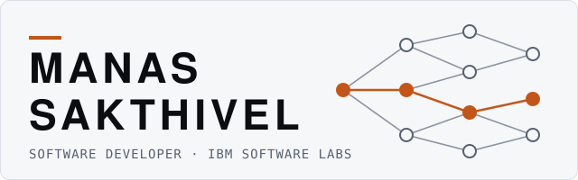
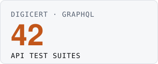
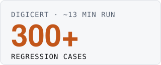
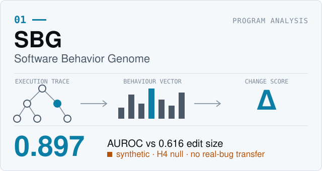
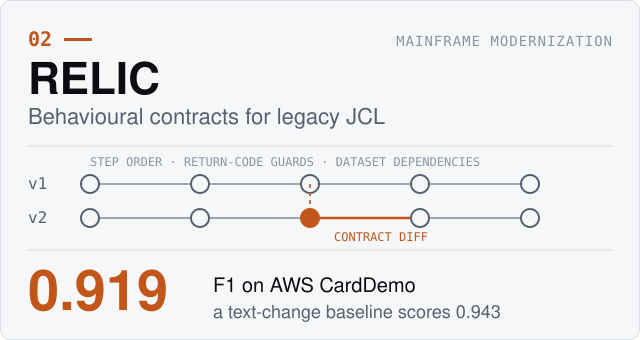
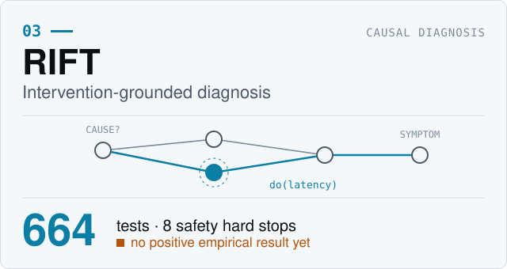
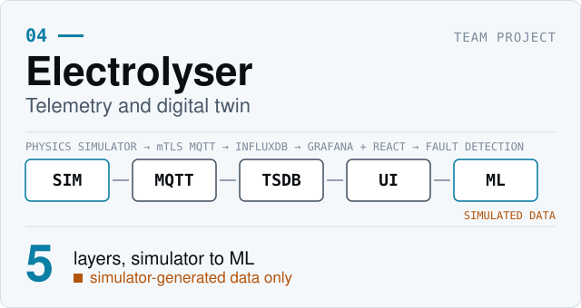
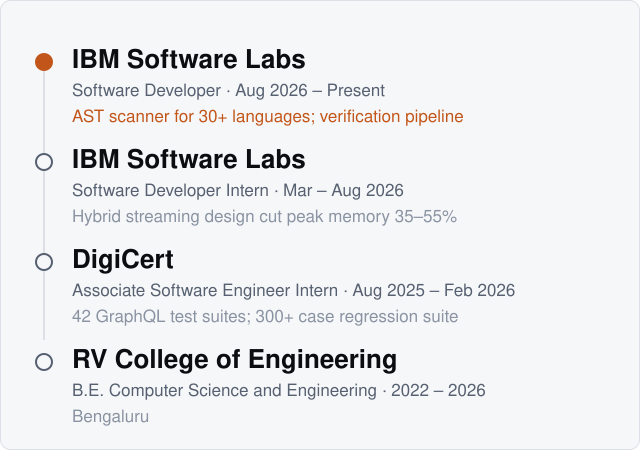

<picture><source media="(prefers-color-scheme: dark)" srcset="assets/hero_dark.svg"/></picture>

# Building systems that make complex software understandable.

**Manas Sakthivel** · Software Developer at IBM Software Labs

I work across software engineering, program analysis, intelligent infrastructure, and applied research — turning complex technical problems into measurable, testable systems.

[Website](https://manas-sakthivel.vercel.app/) · [LinkedIn](https://www.linkedin.com/in/manassakthivel) · [GitHub](https://github.com/ManasSakthivel) · [Email](mailto:manas.mskg@gmail.com)

## Professional snapshot

<table>
<tr>
<td width="50%" valign="top"><picture><source media="(prefers-color-scheme: dark)" srcset="assets/stat1_dark.svg"/></picture> AST scanner parsing 30+ programming languages into one unified JSON representation. IBM Software Labs.</td>
<td width="50%" valign="top"><picture><source media="(prefers-color-scheme: dark)" srcset="assets/stat2_dark.svg"/></picture> An end-to-end verification pipeline across testing and source-analysis tools. IBM Software Labs.</td>
</tr>
<tr>
<td width="50%" valign="top"><picture><source media="(prefers-color-scheme: dark)" srcset="assets/stat3_dark.svg"/></picture> Automated suites covering GraphQL endpoints across backend microservices. DigiCert.</td>
<td width="50%" valign="top"><picture><source media="(prefers-color-scheme: dark)" srcset="assets/stat4_dark.svg"/></picture> Automated regression cases running in about 13 minutes. DigiCert.</td>
</tr>
</table>

Professional engineering figures, self-reported. They are separate from the research results below, which are experimental.

## Selected projects

<picture><source media="(prefers-color-scheme: dark)" srcset="assets/card1_dark.svg"/></picture>

**SBG, Software Behavior Genome.** Represents how a Python program behaves from its execution traces alone, then scores whether a change altered behaviour.

- **Evidence:** AUROC 0.897 vs 0.616 for edit size (19 programs, 638 pairs; synthetic, author-generated benchmark).
- **Limits:** a preregistered hypothesis found no gain over edit size plus simple execution statistics, and it did not transfer to real bugs (BugsInPy 0.497, QuixBugs 0.444). Experimental research, not a production tool.
- `Python` `pytest` · [Repository](https://github.com/ManasSakthivel/Software-Behavior-Genome-SBG-Execution-Grounded-Behavioral-Representation)

<picture><source media="(prefers-color-scheme: dark)" srcset="assets/card2_dark.svg"/></picture>

**RELIC, behavioural contracts for legacy JCL.** Extracts step order, dataset dependencies and return-code guards from mainframe batch jobs and diffs them across versions.

- **Evidence:** F1 0.919 on AWS CardDemo (315 mutants); 0.905 pooled over 566 mutants from three corpora.
- **Limits:** a trivial any-text-change detector scores 0.943 on the same mutants and beats RELIC. The artefacts are JCL, and ground truth is an oracle written by the author.
- `Python` `pytest` `Docker` · [Repository](https://github.com/ManasSakthivel/RELIC)

<picture><source media="(prefers-color-scheme: dark)" srcset="assets/card3_dark.svg"/></picture>

**RIFT, intervention-grounded diagnosis.** Diagnoses root causes in microservices by injecting controlled latency and measuring the downstream change, instead of relying on correlation.

- **Evidence:** 664 tests and 8 safety hard stops.
- **Limits:** no positive empirical result yet. The best variant scores -0.338 mean utility vs 0 for always-abstain on a synthetic benchmark. The test count shows engineering discipline, not research effectiveness.
- `Python` `causal-learn` `networkx` `Docker` `Prometheus` `Jaeger` · [Repository](https://github.com/ManasSakthivel/RIFT-Intervention-Grounded-Detection-of-Behavioral-Divergence)

<picture><source media="(prefers-color-scheme: dark)" srcset="assets/card4_dark.svg"/></picture>

**Electrolyser Telemetry.** An IIoT and digital-twin stack for green hydrogen electrolysers: physics simulator, mTLS MQTT, InfluxDB, Grafana and React, with ML fault detection.

- **Evidence:** team project; I am the third of four authors on the draft paper.
- **Limits:** all telemetry is simulator output. There is no real hardware and no real-deployment claim.
- `Python` `Mosquitto` `InfluxDB` `Grafana` `React` `Docker Compose` `scikit-learn` `PyTorch` · [Repository](https://github.com/ManasSakthivel/Electrolyser-Telemetry)

## Experience

<picture><source media="(prefers-color-scheme: dark)" srcset="assets/timeline_dark.svg"/></picture>

## Technical expertise

<table>
<tr>
<td width="50%" valign="top"><b>Programming</b> Python, Java, JavaScript, Solidity</td>
<td width="50%" valign="top"><b>Systems and infrastructure</b> Linux, Docker, distributed systems, MQTT, InfluxDB, Grafana</td>
</tr>
<tr>
<td valign="top"><b>Software engineering</b> Program analysis, AST processing, mutation testing, API automation, software reliability</td>
<td valign="top"><b>AI and research</b> PyTorch, scikit-learn, causal discovery, machine learning, experimental evaluation</td>
</tr>
</table>

## Research

**Interests:** program analysis · software behaviour and reliability · causal reasoning · legacy system modernization · intelligent engineering infrastructure.

None of this work is published, accepted or under review. Current status:

| Work | Status |
|---|---|
| [SBG](https://github.com/ManasSakthivel/Software-Behavior-Genome-SBG-Execution-Grounded-Behavioral-Representation) | Experimental research; no manuscript yet |
| [RELIC](https://github.com/ManasSakthivel/RELIC) | Manuscript draft in the repository; not peer reviewed |
| [RIFT](https://github.com/ManasSakthivel/RIFT-Intervention-Grounded-Detection-of-Behavioral-Divergence) | Research prototype; no manuscript, no positive result yet |
| [Electrolyser Telemetry](https://github.com/ManasSakthivel/Electrolyser-Telemetry) | Draft paper (third of four authors) |
| [Blockchain Medical Federated Learning](https://github.com/ManasSakthivel/Blockchain-Medical-Federated-Learning) | Unpublished draft; a student prototype, and the zk-STARK component is not implemented |

## Contact

**Engineering systems. Investigating behaviour. Building with evidence.**

[Website](https://manas-sakthivel.vercel.app/) · [LinkedIn](https://www.linkedin.com/in/manassakthivel) · [GitHub](https://github.com/ManasSakthivel) · [Email](mailto:manas.mskg@gmail.com)
