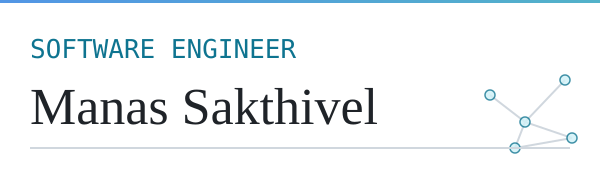

<h1 align="center"><picture>
  <source media="(prefers-color-scheme: dark)" srcset="assets/hero-dark.svg">
  
</picture></h1>

**A software engineer interested in understanding, analysing and improving complex software systems through rigorous engineering and research.**

My projects share one theme, behaviour: what systems do, and what must be preserved when they change. I report what the evidence supports, including when it says no.

Software Developer, IBM Software Labs · B.E. Computer Science and Engineering, RV College of Engineering · [Website](https://manas-sakthivel.vercel.app/) · [LinkedIn](https://www.linkedin.com/in/manassakthivel)

**Projects:** [SBG](#1-software-behavior-genome-sbg) · [RELIC](#2-relic) · [RIFT](#3-rift) · [Electrolyser Telemetry](#4-electrolyser-telemetry) · [Experience](#experience) · [Education](#education)

<picture><source media="(prefers-color-scheme: dark)" srcset="assets/divider-dark.svg"></picture>

## Technical focus

- **Core engineering:** program analysis, software behaviour, legacy (JCL) change analysis, microservice diagnosis, applied ML
- **Research interests:** behavioural representations of software, mutation-based evaluation, causal diagnosis, evaluation methodology and honest baselines
- **Systems and infrastructure:** MQTT with mTLS, InfluxDB, Grafana, Docker Compose, GitHub Actions CI, Online Boutique microservice testbed, Prometheus, Jaeger
- **Languages and tools:** Python, JavaScript (React, Vite), Solidity, Java (RestAssured, TestNG), scikit-learn, PyTorch, pytest, Flask

<picture><source media="(prefers-color-scheme: dark)" srcset="assets/divider-dark.svg"></picture>

## Selected research and engineering

All research projects below use synthetic or author-generated benchmarks. None is externally validated and none has a published paper.

### 1. Software Behavior Genome (SBG)

Execution-grounded behavioural representation of Python programs, used to score whether a change altered behaviour. [Repository](https://github.com/ManasSakthivel/Software-Behavior-Genome-SBG-Execution-Grounded-Behavioral-Representation) · Paper: none (manuscript in preparation).

- **Problem:** can behaviour be represented from execution traces alone, without reading outputs, and compared across program versions?
- **Built:** a pure-standard-library pipeline over call-graph topology, call-order bigrams, exception structure, temporal patterns and value-state transitions, with a size-aware, preregistered evaluation. The repo also documents withdrawn earlier claims and a protocol leak that was found and fixed.
- **Claim:** SBG V5 (the fifth feature set) separates behaviour-changing from behaviour-preserving transformations better than edit size.
- **Evidence:** AUROC 0.897 (95% CI 0.863 to 0.922) vs 0.616 for edit size; 0.875 vs 0.500 with edit size exactly matched. V10 (the tenth, size-aware evaluation round): 19 programs, 638 pairs. AUROC is the chance that a changed pair scores higher than an equivalent one (0.5 is chance).
- **Limits:** synthetic, author-generated benchmark with programs that are siblings of development programs. Hypothesis H4 (a preregistered test) is a null: SBG adds nothing over edit size plus simple execution statistics (+0.006, CI -0.069 to +0.068). It did not transfer to real bugs (BugsInPy AUROC 0.497, QuixBugs 0.444). An earlier frozen test did not demonstrate the method, which led to the redesign.
- **Stack:** Python (standard library only), pytest, Make, GitHub Actions.

### 2. RELIC

Static analyser that extracts behavioural contracts (step order, dataset dependencies, return-code guards) from JCL batch jobs and diffs them between job versions. [Repository](https://github.com/ManasSakthivel/RELIC) · Paper: manuscript draft, not peer reviewed.

- **Problem:** legacy mainframe batch jobs encode behavioural rules that are rarely written down and are easily lost in modernization.
- **Built:** a contract extractor and differ, evaluated by source-level mutation testing with an author-written JCL execution-semantics oracle.
- **Claim:** RELIC detects behaviour-changing JCL mutants with no false positives, as measured against the author's own oracle.
- **Evidence:** on AWS CardDemo (n = 315 mutants): precision 1.000, recall 0.850, F1 0.919 (95% CI 0.88 to 0.95). Pooled over three public corpora (n = 566): F1 0.905.
- **Limits:** a trivial detector that flags any non-comment text change scores F1 0.943 on the same mutants, beating RELIC; RELIC's advantage is specificity (1.000 vs 0.492) at lower recall. An LLM given both job versions scored higher still on a 383-mutant subsample (F1 0.985 vs 0.908). The evaluated artefacts are JCL files, not COBOL source. Ground truth is an oracle by the same author, never checked against real z/OS. An earlier F1 of 1.000 was circular and is withdrawn.
- **Stack:** Python 3.11+, pytest, Docker.

### 3. RIFT

Research prototype for microservice root-cause analysis that injects controlled latency and measures downstream change, instead of relying on correlation. [Repository](https://github.com/ManasSakthivel/RIFT-Intervention-Grounded-Detection-of-Behavioral-Divergence) · Paper: none.

- **Problem:** observability data shows what changed together, not what caused it.
- **Built:** FCI/PAG causal discovery (a constraint-based method that infers a causal graph), an identifiability check, cost-aware intervention selection, `tc netem` latency injection on the Online Boutique testbed, Wasserstein divergence and a Bayesian update that attributes or abstains. 664 tests pass (2 protected-material checks unavailable) with 8 safety hard stops.
- **Claim:** none yet. There is no positive empirical result.
- **Evidence:** on a synthetic simulator benchmark the best variant (V3) does not beat always-abstain on development/validation data (mean utility -0.338 vs 0), and the improvement over V2 is non-confirmatory.
- **Limits:** the confirmatory experiment is preregistered but not run. There is no protected held-out validation and no generalisation claim; the legacy held-out file is public in the repo. Linux testbed results are as reported by the author.
- **Stack:** Python 3.11, causal-learn, scikit-learn, networkx, Docker, Prometheus, Jaeger.

### 4. Electrolyser Telemetry

Five-layer IIoT platform for monitoring green hydrogen electrolysers. Team project; I am the third of four authors on the draft paper. [Repository](https://github.com/ManasSakthivel/Electrolyser-Telemetry) · Paper: draft only.

- **Built:** a physics-based plant simulator (Butler-Volmer, Nernst and ohmic terms, two electrolysers, multiple injectable fault modes), an mTLS MQTT broker, Telegraf into InfluxDB, Grafana and a React SCADA UI, and ML fault detection (Isolation Forest, Random Forest, LSTM autoencoder).
- **Limits:** all telemetry is simulator output; there is no real hardware or real-deployment data, and I make no performance claim for real electrolysers. Fault labels come from the same simulator that generates the features.
- **Stack:** Python, Mosquitto, Telegraf, InfluxDB, Grafana, React, Vite, Docker Compose.

Earlier work: Blockchain Medical Federated Learning

 

Student prototype combining a federated-learning simulation on the UCI Cleveland heart-disease data (303 records), Gaussian differential-privacy noise, additive secret sharing, a Flask EHR app and Solidity contracts. [Repository](https://github.com/ManasSakthivel/Blockchain-Medical-Federated-Learning) · Paper: unpublished draft.

- **Limits:** SHA-256 model hashing only; there is no zk-STARK implementation. The contract's consent gate is optional and disabled by default, and the simulation is not connected to the contracts. Not clinical, not production.
- **Stack:** Python, Flask, Solidity, Truffle, web3.

<picture><source media="(prefers-color-scheme: dark)" srcset="assets/divider-dark.svg"></picture>

## Experience

- **Software Developer**, IBM Software Labs · Aug 2026 to present
- **Software Developer Intern**, IBM Software Labs · Mar 2026 to Aug 2026
- **Associate Software Engineer Intern**, DigiCert · Aug 2025 to Feb 2026. API automation and software testing.

## Education

**B.E. Computer Science and Engineering**, RV College of Engineering · 2022 to 2026

<picture><source media="(prefers-color-scheme: dark)" srcset="assets/footer-dark.svg"></picture>

Website: [manas-sakthivel.vercel.app](https://manas-sakthivel.vercel.app/) · GitHub: [github.com/ManasSakthivel](https://github.com/ManasSakthivel) · LinkedIn: [linkedin.com/in/manassakthivel](https://www.linkedin.com/in/manassakthivel)
