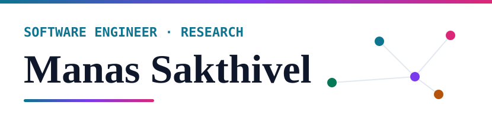
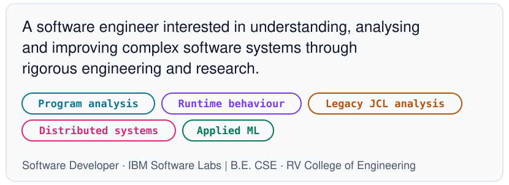
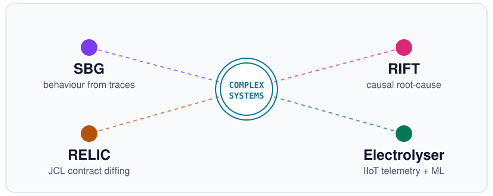
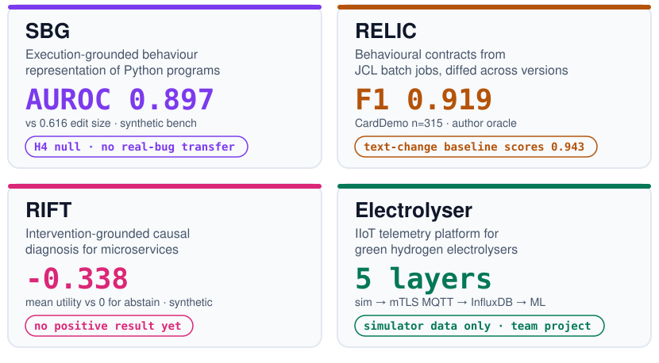
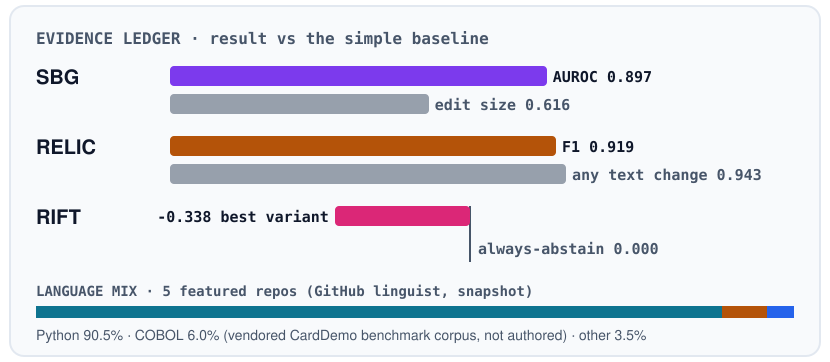
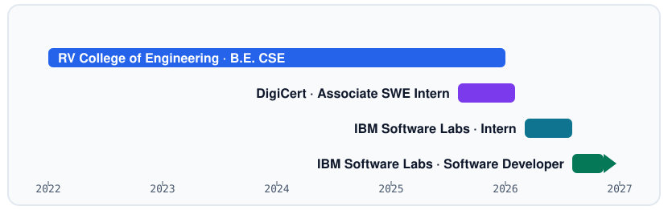
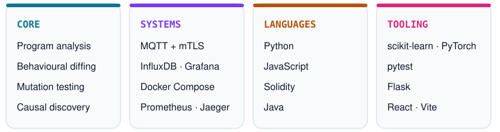

<picture><source media="(prefers-color-scheme: dark)" srcset="assets/dark/header.svg"/></picture>

<a href="https://manas-sakthivel.vercel.app/">Website</a> · <a href="https://www.linkedin.com/in/manassakthivel">LinkedIn</a> · <a href="https://github.com/ManasSakthivel?tab=repositories">Repositories</a>

<picture><source media="(prefers-color-scheme: dark)" srcset="assets/dark/s01.svg"/></picture>
<picture><source media="(prefers-color-scheme: dark)" srcset="assets/dark/whoami.svg"/></picture>

<picture><source media="(prefers-color-scheme: dark)" srcset="assets/dark/s02.svg"/></picture>
<picture><source media="(prefers-color-scheme: dark)" srcset="assets/dark/ecosystem.svg"/></picture>

<picture><source media="(prefers-color-scheme: dark)" srcset="assets/dark/s03.svg"/></picture>
<picture><source media="(prefers-color-scheme: dark)" srcset="assets/dark/projects.svg"/></picture>

All research projects use synthetic or author-generated benchmarks. None is externally validated and none has a published paper. Full claim, evidence and limits for each:

<b>SBG</b> · Software Behavior Genome · <a href="https://github.com/ManasSakthivel/Software-Behavior-Genome-SBG-Execution-Grounded-Behavioral-Representation">repository</a>

 

- **Problem:** can behaviour be represented from execution traces alone, without reading outputs, and compared across program versions?
- **Built:** a pure-standard-library pipeline over call-graph topology, call-order bigrams, exception structure, temporal patterns and value-state transitions, with a size-aware, preregistered evaluation. The repo also documents withdrawn earlier claims and a protocol leak that was found and fixed.
- **Claim:** SBG V5 (the fifth feature set) separates behaviour-changing from behaviour-preserving transformations better than edit size.
- **Evidence:** AUROC 0.897 (95% CI 0.863 to 0.922) vs 0.616 for edit size; 0.875 vs 0.500 with edit size exactly matched. V10 (the tenth, size-aware evaluation round): 19 programs, 638 pairs. AUROC is the chance that a changed pair scores higher than an equivalent one (0.5 is chance).
- **Limits:** synthetic, author-generated benchmark with programs that are siblings of development programs. Hypothesis H4 (a preregistered test) is a null: SBG adds nothing over edit size plus simple execution statistics (+0.006, CI -0.069 to +0.068). It did not transfer to real bugs (BugsInPy AUROC 0.497, QuixBugs 0.444). An earlier frozen test did not demonstrate the method, which led to the redesign.
- **Stack:** Python (standard library only), pytest, Make, GitHub Actions.

<b>RELIC</b> · behavioural contracts for JCL · <a href="https://github.com/ManasSakthivel/RELIC">repository</a>

 

- **Problem:** legacy mainframe batch jobs encode behavioural rules that are rarely written down and are easily lost in modernization.
- **Built:** a contract extractor and differ, evaluated by source-level mutation testing with an author-written JCL execution-semantics oracle.
- **Claim:** RELIC detects behaviour-changing JCL mutants with no false positives, as measured against the author's own oracle.
- **Evidence:** on AWS CardDemo (n = 315 mutants): precision 1.000, recall 0.850, F1 0.919 (95% CI 0.88 to 0.95). Pooled over three public corpora (n = 566): F1 0.905.
- **Limits:** a trivial detector that flags any non-comment text change scores F1 0.943 on the same mutants, beating RELIC; RELIC's advantage is specificity (1.000 vs 0.492) at lower recall. An LLM given both job versions scored higher still on a 383-mutant subsample (F1 0.985 vs 0.908). The evaluated artefacts are JCL files, not COBOL source. Ground truth is an oracle by the same author, never checked against real z/OS. An earlier F1 of 1.000 was circular and is withdrawn.
- **Stack:** Python 3.11+, pytest, Docker.

<b>RIFT</b> · intervention-grounded diagnosis · <a href="https://github.com/ManasSakthivel/RIFT-Intervention-Grounded-Detection-of-Behavioral-Divergence">repository</a>

 

- **Problem:** observability data shows what changed together, not what caused it.
- **Built:** FCI/PAG causal discovery (a constraint-based method that infers a causal graph), an identifiability check, cost-aware intervention selection, `tc netem` latency injection on the Online Boutique testbed, Wasserstein divergence and a Bayesian update that attributes or abstains. 664 tests pass (2 protected-material checks unavailable) with 8 safety hard stops.
- **Claim:** none yet. There is no positive empirical result.
- **Evidence:** on a synthetic simulator benchmark the best variant (V3) does not beat always-abstain on development/validation data (mean utility -0.338 vs 0), and the improvement over V2 is non-confirmatory.
- **Limits:** the confirmatory experiment is preregistered but not run. There is no protected held-out validation and no generalisation claim; the legacy held-out file is public in the repo. Linux testbed results are as reported by the author.
- **Stack:** Python 3.11, causal-learn, scikit-learn, networkx, Docker, Prometheus, Jaeger.

<b>Electrolyser Telemetry</b> · team project, third of four authors · <a href="https://github.com/ManasSakthivel/Electrolyser-Telemetry">repository</a>

 

- **Built:** a physics-based plant simulator (Butler-Volmer, Nernst and ohmic terms, two electrolysers, multiple injectable fault modes), an mTLS MQTT broker, Telegraf into InfluxDB, Grafana and a React SCADA UI, and ML fault detection (Isolation Forest, Random Forest, LSTM autoencoder).
- **Limits:** all telemetry is simulator output; there is no real hardware or real-deployment data, and I make no performance claim for real electrolysers. Fault labels come from the same simulator that generates the features.
- **Stack:** Python, Mosquitto, Telegraf, InfluxDB, Grafana, React, Vite, Docker Compose.

<b>Earlier work</b> · Blockchain Medical Federated Learning (unpublished draft) · <a href="https://github.com/ManasSakthivel/Blockchain-Medical-Federated-Learning">repository</a>

 

Student prototype combining a federated-learning simulation on the UCI Cleveland heart-disease data (303 records), Gaussian differential-privacy noise, additive secret sharing, a Flask EHR app and Solidity contracts.

- **Limits:** SHA-256 model hashing only; there is no zk-STARK implementation. The contract's consent gate is optional and disabled by default, and the simulation is not connected to the contracts. Not clinical, not production.
- **Stack:** Python, Flask, Solidity, Truffle, web3.

<picture><source media="(prefers-color-scheme: dark)" srcset="assets/dark/s04.svg"/></picture>
<picture><source media="(prefers-color-scheme: dark)" srcset="assets/dark/telemetry.svg"/></picture>

<picture><source media="(prefers-color-scheme: dark)" srcset="assets/dark/s05.svg"/></picture>
<picture><source media="(prefers-color-scheme: dark)" srcset="assets/dark/timeline.svg"/></picture>

- **Software Developer**, IBM Software Labs · Aug 2026 to present
- **Software Developer Intern**, IBM Software Labs · Mar 2026 to Aug 2026
- **Associate Software Engineer Intern**, DigiCert · Aug 2025 to Feb 2026. API automation and software testing.
- **B.E. Computer Science and Engineering**, RV College of Engineering · 2022 to 2026

<picture><source media="(prefers-color-scheme: dark)" srcset="assets/dark/s06.svg"/></picture>
<picture><source media="(prefers-color-scheme: dark)" srcset="assets/dark/stack.svg"/></picture>

<picture><source media="(prefers-color-scheme: dark)" srcset="assets/dark/footer.svg"/></picture>

<a href="https://manas-sakthivel.vercel.app/">manas-sakthivel.vercel.app</a> · <a href="https://github.com/ManasSakthivel">github.com/ManasSakthivel</a> · <a href="https://www.linkedin.com/in/manassakthivel">linkedin.com/in/manassakthivel</a>

